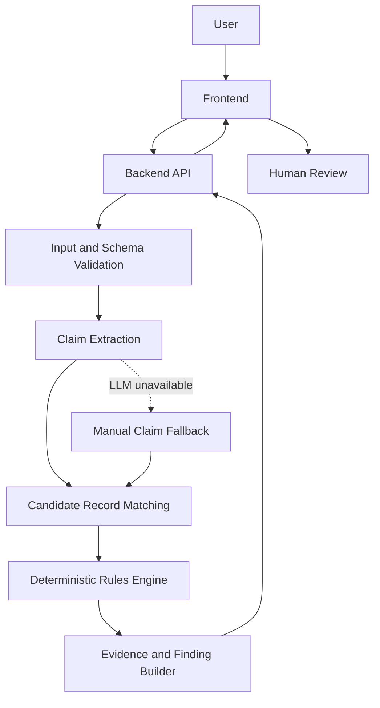

# ProofTrail — System Architecture

**Status:** Proposed implementation architecture  
**Domain:** AI for Business & Commerce  
**MVP workflow:** Short-delivery / quantity discrepancy investigation  
**Primary reference:** `docs/04_DATA_CONTRACTS_AND_ARCHITECTURE.md`

---

## 1. Purpose

This document describes how ProofTrail's application components fit together, how information flows through the system, and which component owns each responsibility.

ProofTrail is an evidence-first investigation assistant for short-delivery disputes between B2B suppliers and buyers.

The architecture must support one reliable workflow:

**Dispute message → claim extraction → record matching → deterministic validation → evidence-linked findings → human review.**

The application must distinguish AI-generated suggestions from verified application findings. It must preserve source traceability, reproduce calculations, handle uncertainty explicitly, and continue operating through a manual or rules-only fallback if the LLM is unavailable.

This document describes the intended architecture. Update implementation-specific details to match the actual repository as development progresses.

## 2. Architecture Principles

1. **Evidence before explanation:** Findings must originate from supplied records and validated application logic.
2. **Deterministic calculations:** Quantity and amount calculations must be performed by application code, not trusted to an LLM.
3. **AI assists; application code validates:** AI can extract claims and suggest candidate records, but its output must pass validation before use.
4. **Uncertainty is a valid result:** Missing, ambiguous, and conflicting information must remain visible.
5. **Traceability by default:** Every material finding must identify the records and calculations supporting it.
6. **Minimal viable architecture:** Build only the components required for the single MVP workflow.
7. **Graceful degradation:** The core investigation must remain usable without model connectivity.
8. **Testability:** The rules engine and evaluation logic must work independently of the user interface and LLM.
9. **No invented evidence:** AI must never create authoritative record IDs, source records, or unsupported conclusions.
10. **Human review:** The system assists investigation; the user remains responsible for decisions and external responses.

## 3. System Overview

The proposed MVP uses a frontend, a backend application, an AI adapter, a deterministic investigation engine, and validated input records.



The diagram represents logical responsibilities, not necessarily separate deployable services.

For the hackathon, these components should preferably live in one backend application unless the team's chosen stack or an existing implementation provides a clear reason to separate them.

### Main components

| Component | Responsibility |
|---|---|
| Frontend | Accept the dispute message and records, display findings, and support review. |
| Backend API | Validate requests, coordinate the investigation, and return structured results. |
| Input validation | Check required fields, types, identifiers, and data consistency. |
| Claim extraction | Convert informal dispute text into a validated structured claim. |
| Candidate matching | Identify possible relevant records using defined matching rules and optional AI suggestions. |
| Deterministic rules engine | Compare compatible records, perform arithmetic, and classify findings. |
| Evidence builder | Attach source identifiers, calculations, assumptions, and limitations to findings. |
| AI adapter | Encapsulate provider calls, structured-output handling, timeouts, and error handling. |
| Evaluation runner | Run labelled synthetic cases against the rules-only and hybrid approaches. |

These are logical modules. Do not create separate microservices, queues, or deployment infrastructure merely to match the diagram.

## 4. End-to-End Investigation Flow

### Step 1 — Receive the investigation request

The user supplies:

- A dispute message.
- Structured business records in a supported format.
- Any required transaction or shipment context available in the interface.

The backend receives the request and validates its structure.

Invalid records must produce clear validation errors or explicit exclusions. They must not silently become valid evidence.

### Step 2 — Validate and normalize the input

The application validates the supported record types and normalizes only fields for which normalization rules are defined.

Examples include:

- Parsing numeric quantities.
- Validating date formats.
- Checking required identifiers.
- Applying consistent string normalization to reference fields.
- Ensuring units and currencies are represented explicitly.
- Identifying duplicate or conflicting records where the rules support it.

Normalization must not erase meaningful distinctions between records.

For example, two similar shipment references must not automatically be treated as the same shipment without satisfying the matching policy.

### Step 3 — Extract the claim

The AI adapter may send the dispute message to an available LLM for structured claim extraction.

The output may identify:

- The alleged discrepancy.
- The claimed or expected quantity.
- The item or product reference, if present.
- The relevant transaction or shipment reference, if present.
- The claimed amount or deduction, if present.
- Relevant dates, if explicitly stated.
- Fields that remain unknown.

The extraction result must pass schema validation before the investigation proceeds.

The original message should remain available for user review. Extracted fields must not be presented as verified facts merely because the model produced them.

If the model is unavailable or returns invalid output, the application should allow manual entry of the claim fields.

### Step 4 — Identify candidate records

The matching module finds records that may be relevant to the claim.

The MVP should prioritize:

1. Exact identifiers and references.
2. Explicit links between records.
3. Defined comparisons of compatible fields.
4. Optional AI-assisted candidate suggestions when the simpler approach is insufficient.

A suggested match is not automatically a confirmed match.

The application should retain enough information to explain why a candidate was selected, such as a matching shipment reference or a matching transaction identifier.

If multiple records are plausible, the system must preserve the ambiguity rather than silently choosing one.

### Step 5 — Run deterministic checks

The rules engine receives validated records and the matching results.

It performs the supported comparisons, including:

- Invoiced quantity versus received quantity.
- Dispatch quantity versus received quantity.
- Applicable unit-price calculations.
- Recorded payments and invoice amounts.
- Presence or absence of linked credit-note records in the supplied dataset.
- Defined consistency checks across transaction references.

Only comparisons supported by compatible fields and the defined matching rules should be performed.

The engine must not infer intent, determine fraud, or decide which party is legally correct.

### Step 6 — Build evidence-linked findings

The evidence builder converts validated results into structured findings.

Each finding should contain, where applicable:

- A stable finding identifier.
- A concise description.
- The finding status.
- Relevant source record IDs.
- The calculation or comparison performed.
- Assumptions.
- Limitations.
- Suggested verification steps.

The builder must verify that referenced source IDs actually exist in the investigation's validated input.

A missing source must never be replaced with a fabricated identifier.

### Step 7 — Return findings for human review

The frontend displays the findings, evidence, calculations, uncertainty, and next steps.

The user should be able to distinguish:

- What the records support.
- What the records contradict.
- What was not found in the supplied dataset.
- What remains unresolved.

The application must not automatically send a payment demand, reject a buyer's claim, or make a legal determination.

### Step 8 — Evaluate the workflow

The evaluation runner executes a fixed set of labelled synthetic cases against the rules-only and hybrid pipelines.

The evaluation should measure relevant correctness metrics and record failures.

Evaluation output must remain separate from customer-facing investigation findings. A model's benchmark score must not be used as proof that an individual dispute is correct.

## 5. Finding Statuses

Use the canonical status definitions in `docs/04_DATA_CONTRACTS_AND_ARCHITECTURE.md`.

The intended MVP statuses are:

| Status | Meaning |
|---|---|
| `SUPPORTED_BY_RECORDS` | The supplied, relevant records support the stated finding under the defined rules. |
| `CONFLICTING_RECORDS` | Relevant supplied records disagree or cannot be reconciled using the current rules. |
| `NOT_FOUND_IN_PROVIDED_DATA` | The expected record or evidence was not found in the supplied dataset. |
| `UNRESOLVED` | The available information is insufficient or too ambiguous to support a reliable conclusion. |

### Status safeguards

- A record being absent from the upload does not prove it does not exist elsewhere.
- A dispatch record does not, by itself, prove delivery or receipt.
- A partial payment does not, by itself, establish the reason for the payment difference.
- A quantity discrepancy does not establish fraud or intent.
- A matching reference does not prove that every field in a record is correct.
- A finding must not receive a stronger status than its supporting evidence justifies.

Status assignment belongs to deterministic application logic and defined rules, not free-form LLM judgment.

## 6. Module Responsibilities and Boundaries

### 6.1 Frontend

**Owns:**

- Input forms.
- Record upload or structured-record entry supported by the MVP.
- Claim review and correction.
- Investigation progress and errors.
- Evidence presentation.
- Calculation and source-reference display.
- Human review of unresolved findings.

**Does not own:**

- Authoritative calculations.
- Final finding classification.
- Source record validation.
- AI-generated conclusions.
- Evaluation metric calculations.

The frontend may format values for display, but the backend's validated result remains authoritative.

### 6.2 Backend API and orchestration

**Owns:**

- Request validation.
- Investigation orchestration.
- Calling the relevant modules in the correct order.
- Error handling and response construction.
- Passing validated inputs between modules.
- Returning structured findings to the frontend.

The orchestration layer should coordinate modules rather than duplicate their business rules.

### 6.3 AI adapter

**Owns:**

- Provider-specific requests.
- Prompt and structured-output configuration.
- Parsing model responses.
- Handling timeouts and provider errors.
- Returning validated or explicitly failed extraction results.
- Keeping provider-specific details out of the rules engine.

**Does not own:**

- Final arithmetic.
- Source record creation.
- Authoritative matching decisions.
- Final evidence status.
- Legal, fraud, or liability judgments.

The rest of the application should not need to know which provider is used to extract a claim.

### 6.4 Matching module

**Owns:**

- Applying explicit identifier and reference matching rules.
- Generating candidate records.
- Recording the basis for candidate selection.
- Flagging ambiguous matches.
- Passing candidate references to downstream validation.

If AI-assisted matching is implemented, its suggestions must be validated against the actual record set.

### 6.5 Deterministic rules engine

**Owns:**

- Quantity comparisons.
- Compatible amount calculations.
- Defined cross-record consistency checks.
- Rule-based finding classification.
- Missing and conflicting evidence handling.
- Reproducible calculations.

The rules engine should be testable without a frontend, database, or external LLM.

### 6.6 Evidence builder

**Owns:**

- Linking findings to valid source IDs.
- Preserving calculation details.
- Recording assumptions and limitations.
- Producing a stable finding structure.
- Preventing unsupported source references from reaching the final response.

### 6.7 Evaluation runner

**Owns:**

- Loading labelled synthetic cases.
- Executing the configured evaluation paths.
- Comparing predictions with expected outcomes.
- Calculating metrics from actual results.
- Reporting failures and denominators.
- Keeping the test data and results reproducible.

Do not mix evaluation-only shortcuts into the production investigation path.

## 7. Data and Storage Strategy

The storage design should remain proportional to the MVP.

### Initial implementation

For the hackathon, validated CSV/JSON records can be held in application memory during a single investigation, provided the request size is manageable and no persistent storage is required for the demo.

If the team already has a working database integration, it can be used where it materially improves the implementation. Do not add a database solely for architectural appearance.

### If persistence is implemented

The application should distinguish between:

- Investigation metadata.
- Validated source records.
- Extracted claims.
- Candidate matching results.
- Deterministic findings.
- Evaluation cases and results.

Maintain stable identifiers and relationships between findings and their source records.

Do not use model-generated summaries as the only stored representation of the evidence.

### Future considerations

If ProofTrail progresses beyond the prototype, persistent storage, authentication, tenant isolation, audit history, access control, retention policies, and data deletion will require a more complete design.

These capabilities are not implied to exist in the hackathon MVP.

## 8. API and Contract Boundaries

The exact schemas and endpoint definitions are maintained in:

`docs/04_DATA_CONTRACTS_AND_ARCHITECTURE.md`

That document is the canonical reference for the shared data contracts.

The intended API responsibilities include:

| Endpoint | Responsibility |
|---|---|
| `POST /api/investigations` | Validate an investigation request, run the supported workflow, and return structured findings. |
| `POST /api/evaluate` | Run the defined evaluation process if evaluation is exposed through the application API. |

The evaluation endpoint is optional for the user-facing application. A local script or test runner may be simpler and safer for the hackathon.

Do not create multiple competing versions of the same schema in the frontend, backend, and documentation.

If a contract change becomes necessary:

1. Update the canonical contract.
2. Update the backend implementation.
3. Update frontend types or request handling.
4. Update synthetic test fixtures.
5. Run the affected tests.
6. Record a material decision in `docs/09_DECISIONS_AND_OPEN_QUESTIONS.md`.

## 9. Error Handling and Graceful Degradation

The system should fail explicitly and safely.

| Failure | Expected behavior |
|---|---|
| Invalid input schema | Return a clear validation error; do not investigate invalid records as if they were valid. |
| Missing required fields | Request correction or preserve the case as unresolved where appropriate. |
| LLM unavailable | Allow manual claim entry and continue through supported deterministic checks. |
| Invalid model output | Reject the invalid output and request correction or use the fallback. |
| Ambiguous candidate matches | Preserve the candidates and mark the relevant conclusion unresolved. |
| Missing receipt record | Report that receipt evidence was not found in the supplied dataset. |
| Conflicting quantities | Surface the conflict with source IDs and reproducible comparisons. |
| Incompatible units or currencies | Block the affected comparison until a valid conversion or compatible representation is available. |
| Unknown record reference | Reject or flag the reference; never fabricate a source record. |
| Calculation failure | Return an explicit error or unresolved result rather than a guessed value. |
| Frontend display failure | Preserve the underlying structured response and provide a clear failure state where feasible. |

Error handling must not silently convert a failed operation into a confident positive finding.

## 10. Security and Privacy

The hackathon implementation must:

- Use synthetic records for the main demonstration.
- Avoid submitting real customer records to external LLM providers.
- Keep API keys and credentials out of source control.
- Avoid logging sensitive payloads unnecessarily.
- Validate incoming data before passing it to downstream components.
- Treat dispute text and record contents as untrusted input.
- Prevent instructions embedded in supplied text from overriding application rules or changing the evidence policy.

If real customer data is considered later, the team must separately review authorization, privacy, access control, retention, data-processing arrangements, and the selected model provider's terms before use.

## 11. Testing Strategy

Test each logical responsibility independently before relying on the end-to-end demo.

### Unit tests

Test:

- Input schema validation.
- Identifier and reference matching.
- Quantity and amount calculations.
- Unit and currency compatibility.
- Finding status assignment.
- Source ID integrity.
- Invalid AI-output handling.
- Correct behavior when information is missing.

### Integration tests

Test the full workflow for:

1. A consistent case with no quantity discrepancy.
2. A short-delivery case with a relevant receipt record.
3. An ambiguous case with multiple possible matching records.
4. A missing-evidence case.
5. A contradictory-record case.
6. An LLM failure or invalid-output case.

### Evaluation tests

Use the labelled synthetic cases defined in `docs/06_SYNTHETIC_TEST_CASES.md`.

Compare the hybrid and rules-only paths using the metrics defined in `docs/05_AI_ROLE_AND_EVALUATION.md`.

Do not change expected results simply to make the implementation pass. If an expected result is incorrect, document the correction and its reasoning.

### End-to-end acceptance

Before feature freeze, verify that:

- The user can submit a supported investigation.
- The claim can be entered manually if AI is unavailable.
- Relevant records are matched according to explicit rules.
- Calculations are reproducible.
- Findings cite valid source records.
- Missing or conflicting evidence is visible.
- Unsupported conclusions are not presented as facts.
- The demonstration works from a clean start.

## 12. Recommended Repository Structure

Use this as a starting point, not a mandatory directory tree. Adapt it to the team's actual framework and existing repository.

```text
prooftrail/
├── README.md
├── docs/
│   ├── 01_PRODUCT_BRIEF.md
│   ├── 02_DIFFERENTIATION_AND_COMPETITORS.md
│   ├── 03_SCOPE_AND_ACCEPTANCE_CRITERIA.md
│   ├── 04_DATA_CONTRACTS_AND_ARCHITECTURE.md
│   ├── 05_AI_ROLE_AND_EVALUATION.md
│   ├── 06_SYNTHETIC_TEST_CASES.md
│   ├── 07_EIGHT_HOUR_EXECUTION_PLAN.md
│   ├── 08_DEMO_AND_JUDGE_DEFENSE.md
│   ├── 09_DECISIONS_AND_OPEN_QUESTIONS.md
│   └── ARCHITECTURE.md
├── frontend/
│   └── ...
├── backend/
│   └── ...
├── tests/
│   ├── unit/
│   ├── integration/
│   └── evaluation/
├── data/
│   └── synthetic/
└── .env.example
```

This is a proposed logical structure. If the selected framework uses a different convention, prefer the working framework convention over forcing this exact layout.

Never commit actual secrets in `.env.example`; include only placeholder variable names.

## 13. Implementation Order

The recommended build sequence is:

1. Define and validate the canonical input and output schemas.
2. Create one canonical synthetic investigation case.
3. Implement the deterministic rules engine.
4. Test the calculation and finding logic independently.
5. Implement the backend investigation endpoint.
6. Connect the frontend using the agreed request and response contract.
7. Add claim extraction through the AI adapter.
8. Add candidate matching only to the extent required by the chosen MVP.
9. Build the source-linked evidence display.
10. Run the hybrid-versus-rules-only evaluation.
11. Test ambiguous cases and the model-unavailable fallback.
12. Freeze features and rehearse the demonstration.

The team may work on independent modules in parallel, but the first end-to-end integration must happen early. A complete vertical slice is more valuable than several individually polished components that cannot communicate.

## 14. Definition of Done

The architecture is adequately implemented for the hackathon when:

- The core workflow works end-to-end.
- The frontend and backend use consistent contracts.
- The AI adapter is isolated from deterministic business logic.
- Calculations are performed and tested in application code.
- Material findings have valid source references.
- Uncertainty and conflicting evidence are represented explicitly.
- The manual or rules-only fallback works.
- The synthetic evaluation can be reproduced.
- The demo does not rely on invented results or unverified claims.
- The actual repository structure and implemented behavior are documented accurately.

Production deployment, customer-data readiness, commercial validation, and comprehensive security certification are outside this definition of done.

## 15. Final Architecture Rule

ProofTrail's architecture should make one distinction impossible to miss:

**AI interprets and suggests. Deterministic code validates and calculates. Evidence records what supports the result. The human reviews the conclusion.**

Every implementation decision should reinforce that separation.

If a proposed component does not help deliver the core investigation, preserve evidence integrity, measure AI contribution, or improve the reliability of the demonstration, it should not be added to the eight-hour MVP.